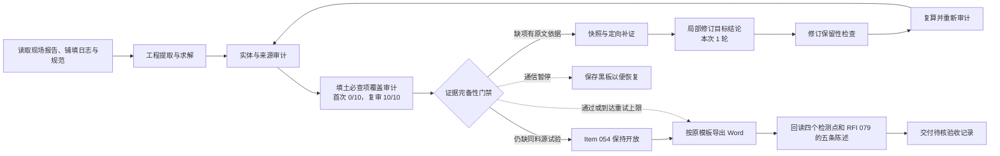

# PLE 第二周｜RSI 人工编排与工程复核

截至 2026-11-28，六道开发题均已接入 RSI 前端画布。按十条问题各自的验收判据，**4 条已通过，2 条部分完成，4 条尚未通过**。

| 范围 | 当前结论 | 最新证据 |
| --- | --- | --- |
| LES · P01–P03 | P01、P02 尚未通过。P03 已保持审查项开放，亚网格闭合及补记位置仍待写入。最新 Word 得 7/82。 | [逐项评分](progress-2026-11-28/les-latest-grade.json) · [P01 操作数回放](progress-2026-11-28/les-p01-node-replay.json) · [画布](progress-2026-11-28/canvases/les.png) |
| 填土 · P04–P05 | 固定回复回放分别得 31/31 与 9/9。新版拆分规则可逐点核验 FD-14 至 FD-17，通用自动清单版待端到端复测。 | [评分](fill/coverage-gate/grade.json) · [节点对照](progress-2026-11-28/estimate-fill-decision-split.json) · [画布](progress-2026-11-28/canvases/fill.png) |
| 工程估算 · P06–P07 | 清单行匹配回放 2/46 → 3/46，P06 新增对账表得分，关键数量和小计仍待修。P07 尚未在评分稿写出坡道无对应项。新版盘点已能独立识别坡道。 | [首轮评分](progress-2026-11-28/estimate-first-grade.json) · [回放评分](progress-2026-11-28/estimate-map-replay-grade.json) · [画布](progress-2026-11-28/canvases/estimate.png) |
| 景观 · P08 | 通用自动清单版 P08 得 20/20，整题 65/77，保留书面认定待核。 | [评分](checklist-extraction/landscape/grade.json) · [画布](progress-2026-11-28/canvases/landscape.png) |
| E119 · P09 | 整题本地评分 52/208 → 75/208，三条归因判据仍为 0/30。新版定向返修在固定回复回放中通过，待生成并复评真实模型产物。 | [评分](progress-2026-11-28/fire-scored-grade.json) · [回放](progress-2026-11-28/fire-controlled-replay.json) · [画布](progress-2026-11-28/canvases/fire.png) |
| 数据中心 · P10 | 同一历史 IFC 旧门禁放行，增强门禁返回返修。编码及几何修正后，原评分器成功进入工程约束评估，满足 11/17 项，得 0.324。 | [门禁对照](progress-2026-11-28/ifc-gate-comparison.json) · [评分](progress-2026-11-28/ifc-original-grader-comparison.json) · [画布](progress-2026-11-28/canvases/site.png) |

## 早期三题结果与复核材料

| 任务 | 编排与核验结果 | 证据 |
| --- | --- | --- |
| LES 网格分辨率（P01–P03） | 参数提取 → 物理复算 → 实体和来源审计 → 覆盖审计 → 门禁 → 有限局部修订或待核交付。真题两轮重试后保持 `EVIDENCE_HOLD`，Word 回读通过。C3 仍为 7.52，回放定位到参数实体或适用范围不匹配。P01、P02 待修复，P03 已保留审查项开放，仍缺 SGS 闭合记录位置。 | [真题黑板](les/run-joro928i/blackboard.json) · [Word](les/run-joro928i/CFDME-2025-041_resolution_note_revA.docx) · [后端单节点回放](les/single-node-live/replay-result.json) · [离线诊断](les/offline-diagnosis.json) · [历史回放评分](les/scoring/grade-les-tsYYxeD9/) |
| 填土压实验收（P04–P05） | 本地原评分器复测 **15/108 → 24/108 → 78/108（72.2%）**。新版固定回复回放沿用同一初稿，一次局部修订后覆盖清单 **0/10 → 10/10**。P04 **11/31 → 31/31**，P05 **9/9 → 9/9**，首轮已有得分均保留。Item 054 保持开放。 | [首轮评分](fill/scoring/grade-fill-compaction-acceptance-1rM5Jqmx/grade.json) · [新版逐项评分](fill/coverage-gate/grade.json) · [新版回放和交付物](fill/coverage-gate/) |
| 景观 L-4 修订（P08） | 核对批准函 Condition 14、HOA 公共区域、图纸数量和听证日历 → 经证据门禁导出备忘录 → 回读。原评分器本地复测 **70/77（90.9%）**，基线 **12/77**。P08 部分修复，**0/20 → 13/20**。图纸 58 株、复算 208 株。书面重大变更判定待取得，暂不承诺 11 月 30 日重提，状态为 `EVIDENCE_HOLD`。 | [评分明细](landscape/scoring/grade-landscape-sheet-revision-3ukqY0iP/grade.json) · [运行结果](landscape/scoring/grade-landscape-sheet-revision-3ukqY0iP/results.json) · [黑板](landscape/blackboard.json) · [备忘录](landscape/Memo_to_Callaway_L4_Revision.docx) · [版面预览](landscape/render/memo.pdf) |

景观历史人工专用版的 Condition 14 引用（#1）得 **5/5**，适用性判断（#2）得 **8/8**。其唯一扣分项（#0，**0/7**）是缺少 Condition 14 对工作人员层级处置的直接约束。[历史人工版逐项评分](landscape/scoring/grade-landscape-sheet-revision-3ukqY0iP/grade.json)

填土题新版比首轮多 **54 分**。四个检测点的验收依据、逐点处置及补试要求贡献 32 分，Item 012 贡献 9 分，施工暂缓与解除条件贡献 7 分，其余报告及规范细节贡献 6 分。仍缺具体规范条款、SF-26-0708 的重新签发要求、连续专项检查的出勤证据等。覆盖门禁版首次裁判调用超时，随后对同一评分包重跑得 78/108。两轮候选均采用固定回复回放。 [同初稿对照](fill/coverage-gate/comparison.json) · [裁判超时](fill/coverage-gate/judge-timeout.json) · [重跑结果](fill/coverage-gate/results.json)

LES 的历史基线为 2/82，审计意见重建的历史回放为 7/82。两次用到的交付材料不同。按操作数补证的新版节点已在历史黑板上验证，待生成新的交付物复评。

## 必查项提取实验

景观通用自动版提取了 **13 条**必查项，Word 回读通过，原评分器本地实测 **65/77**，P08 **20/20**。自动版补回了 Condition 14 约束的 7 分，在 HOA 权属、TAB 已关闭申报窗口和 TAB 建议转交权限上共失 12 分。首次 `HTTP 401` 的评分标记为未测得。 [实验记录](checklist-extraction/README.md) · [逐项评分](checklist-extraction/landscape/grade.json)

填土通用自动版首跑的必查项引用无法核验，未生成 Word。路径规范化、原文回读、一次定向修引用和有效项保留已完成本地模拟验证。实际模型复跑和同流程人工清单对照待完成。[运行记录](checklist-extraction/fill/run.json) · [实验 CSV](必查项提取实验记录.csv)

## 历史填土编排可视化

前端首页选择「填土压实验收」可预览本次回放路径。图中的虚线表示其他运行可能走的路径。 [RSI 前端画布截图](fill/coverage-gate/rsi-canvas.png)



图中保留的是提交 `fcb349e` 对应的历史固定回复回放。当前填土和景观的求解与审计读同一格式的必查项清单，共用 Word 导出和回读。针对同一份 LES 测试输入的前后对照中，求解、覆盖审计和证据门禁的输出及模型请求参数一致。

## 表格与其他证据

- [10 条问题最新进度 CSV](周任务_10条修复对照.csv) · [10 条问题对照 Excel（评分前快照）](周任务_10条修复对照.xlsx)
- [六题基线评分及验证器输出](baseline/)
- [LES 历史评测目录](les/scoring/) · [填土执行日志](fill/runtime.log) · [填土离线联调样例](fill/fixture/)
- [节点回放与通信故障证据](节点回放与通信故障证据.csv) · [故障注入、恢复和 Word 回放快照](recovery/)
- [必查项提取实验 CSV](必查项提取实验记录.csv) · [实验口径、逐项分差与新证据](checklist-extraction/README.md)
- [后端联调截图](setup/work1.png) · [画布初始化截图](setup/work2.png)。两张图记录环境联调。[填土画布截图](fill/coverage-gate/rsi-canvas.png)记录已完成回放的路径。

表格证据路径相对于本目录。原始黑板和运行快照内的本机路径保留为运行元数据。可直接从本目录打开相应的交付物和证据。

## 原子能力与代码

目前注册十个通用原子能力，包括工作区侦察、必查项提取、工程提取与求解、实体与来源隔离审计、集合覆盖与归因审校、证据完备性门禁、产物回读、物理派生量复算、定向补证和修订保留性检查。填土与景观使用同一套清单接口和 Word 交付节点。[必查项提取注册](../../../experiments/rsi/rsi-flow-spring-boot/core-flow/src/main/resources/flow/Skills/flow-requirement-extraction.json)

- [前端 rsi-flow-platform](../../../experiments/rsi/rsi-flow-platform/)
- [画布组件 rsi-flow-visual](../../../experiments/rsi/rsi-flow-visual/)
- [后端 rsi-flow-spring-boot](../../../experiments/rsi/rsi-flow-spring-boot/) · [流程定义](../../../experiments/rsi/rsi-flow-spring-boot/core-flow/src/main/resources/flow/Orchestration/) · [原子能力注册](../../../experiments/rsi/rsi-flow-spring-boot/core-flow/src/main/resources/flow/Skills/)

## 复跑

将三个项目保持在 `experiments/rsi` 下的同级目录。前端使用本地画布包，设置 `RSI_BACKEND_ORIGIN` 为本机后端地址。后端需要本地 RSI 依赖及任务材料，在 IDEA 中重新构建并启动本机配置，脚本默认使用 18080 端口。将 `PLE_TASK_ROOT` 指向原题目录的父目录，并按需在本机配置模型访问。后端的 `test`、`remote` 数据源从 `RSI_DB_URL`、`RSI_DB_USERNAME`、`RSI_DB_PASSWORD` 获取配置。

从仓库根目录在 PowerShell 执行一条对应任务的命令。

```powershell
& .\experiments\rsi\run_les_review.ps1 -TaskId les-mesh-resolution -TaskRoot '<原题目录的父目录>'
& .\experiments\rsi\run_les_review.ps1 -TaskId fill-compaction-acceptance -TaskRoot '<原题目录的父目录>'
& .\experiments\rsi\run_les_review.ps1 -TaskId landscape-sheet-revision -TaskRoot '<原题目录的父目录>'
```

填土与景观默认走模型自动提取。人工组传入 `-ChecklistPath '<人工清单.json>'`，文件顶层是 `required_checks` 数组，每项包含 `id`、`description`、`applies_when`、`acceptance` 和 `provenance`。

已有黑板可以通过 [replay_review.py](../../../experiments/rsi/replay_review.py) 回放必查项提取、复算或重新导出。出现 `TRANSPORT_PAUSED` 时，从该次运行的 `final.json` 执行 `resume`。通信重试与工程重试独立记录。
